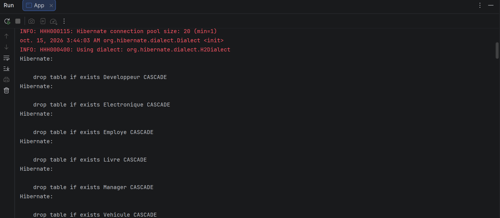
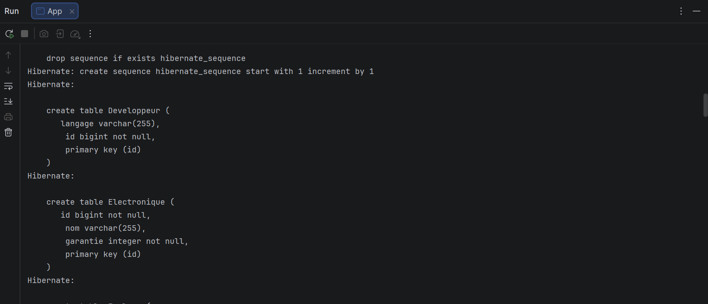
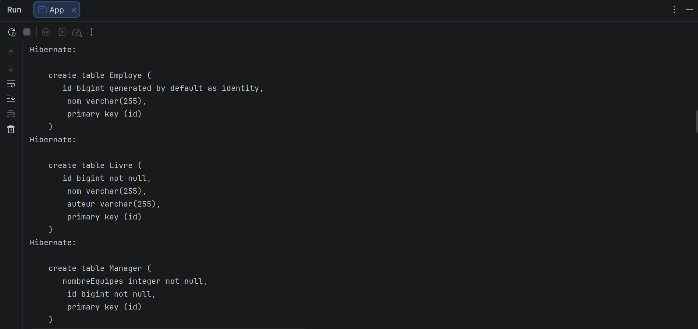
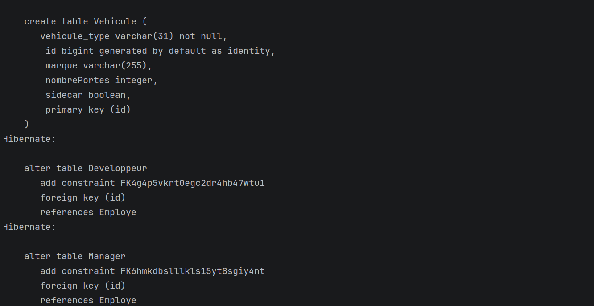

# TP 4 : Héritage avec Hibernate, stratégies de mapping

**Réalisé par :** Zakaria Laalyej (2DSI)

Projet réalisé dans le cadre du module JEE / Persistance des données avec Hibernate et JPA.
Il met en œuvre les trois stratégies de mapping d'héritage de JPA sur une base H2 en mémoire,
et analyse le SQL généré automatiquement par Hibernate.

## Objectifs

- Implémenter les trois stratégies d'héritage supportées par JPA / Hibernate :
  - `SINGLE_TABLE` : une table unique pour toute la hiérarchie
  - `JOINED` : une table par classe, reliées par clé étrangère
  - `TABLE_PER_CLASS` : une table par classe concrète
- Analyser les requêtes SQL DDL générées (tables, séquence, contraintes) et comparer les stratégies.

## Technologies

- Java 17
- Maven
- Hibernate 5.6 (JPA 2.2, `javax.persistence`)
- H2 (en mémoire)
- JUnit

## Modélisation des entités

```
                  [Héritage JPA]
                        │
     ┌──────────────────┼──────────────────┐
     ▼                  ▼                  ▼
1. SINGLE_TABLE     2. JOINED       3. TABLE_PER_CLASS
   (Vehicule)        (Employe)           (Produit)
   ├── Voiture       ├── Developpeur     ├── Livre
   └── Moto          └── Manager         └── Electronique
```

### 1. SINGLE_TABLE (hiérarchie Vehicule)

Toutes les classes (`Vehicule`, `Voiture`, `Moto`) sont stockées dans **une seule table** `Vehicule`.
La colonne discriminante `vehicule_type` indique le type réel de chaque ligne.
Les colonnes propres aux sous-classes (`nombrePortes`, `sidecar`) sont nullables, car elles
restent vides pour les lignes des autres types.

### 2. JOINED (hiérarchie Employe)

Une table mère `Employe` contient les attributs communs (`nom`), et une table par sous-classe
(`Developpeur`, `Manager`) contient les attributs spécifiques (`langage`, `nombreEquipes`).
La clé primaire des tables filles est aussi une **clé étrangère** vers `Employe`.

### 3. TABLE_PER_CLASS (hiérarchie Produit)

Aucune table n'est créée pour la classe abstraite `Produit`. Chaque classe concrète
(`Livre`, `Electronique`) a sa propre table avec **toutes** ses colonnes, y compris celles
héritées (`nom`). Comme les identifiants doivent rester uniques dans toute la hiérarchie,
Hibernate utilise une séquence globale, `hibernate_sequence`.

## Captures d'exécution et analyse du SQL

Au lancement de `App`, Hibernate génère le schéma à partir des entités
(`hibernate.show_sql` et `hibernate.format_sql` activés).

### 1. Nettoyage initial du schéma (drop)



Hibernate commence par supprimer les tables existantes, avec l'option `CASCADE` pour ignorer
les contraintes qui les relient : `Developpeur`, `Electronique`, `Employe`, `Livre`,
`Manager`, `Vehicule`. On remarque aussi le dialecte détecté, `H2Dialect`.
Il n'y a **aucun `drop table Produit`** : la classe abstraite n'a pas de table.

### 2. Séquence globale, tables Developpeur et Electronique



```sql
drop sequence if exists hibernate_sequence
create sequence hibernate_sequence start with 1 increment by 1

create table Developpeur (langage varchar(255), id bigint not null, primary key (id))
create table Electronique (id bigint not null, nom varchar(255), garantie integer not null, primary key (id))
```

- `hibernate_sequence` est créée pour la stratégie **TABLE_PER_CLASS**.
- `Developpeur` (**JOINED**) ne contient que sa colonne spécifique `langage`. Son `id` est
  `not null` sans `identity`, car il reprend la valeur de l'`id` d'`Employe`.
- `Electronique` (**TABLE_PER_CLASS**) contient `nom` (hérité) et `garantie`. Son `id` n'est
  pas auto-incrémenté : il vient de la séquence.

### 3. Tables Employe, Livre et Manager



```sql
create table Employe (id bigint generated by default as identity, nom varchar(255), primary key (id))
create table Livre (id bigint not null, nom varchar(255), auteur varchar(255), primary key (id))
create table Manager (nombreEquipes integer not null, id bigint not null, primary key (id))
```

- `Employe` est la table mère de la hiérarchie **JOINED** : elle génère les identifiants (`identity`).
- `Manager` contient seulement `nombreEquipes` et l'`id` partagé avec `Employe`.
- `Livre` (**TABLE_PER_CLASS**) répète la colonne `nom`, qui existe aussi dans `Electronique`.
  C'est la **redondance** propre à cette stratégie.

### 4. Table Vehicule et clés étrangères



```sql
create table Vehicule (
    vehicule_type varchar(31) not null,
    id bigint generated by default as identity,
    marque varchar(255),
    nombrePortes integer,
    sidecar boolean,
    primary key (id)
)

alter table Developpeur add constraint FK4g4p5vkrt0egc2dr4hb47wtu1 foreign key (id) references Employe
alter table Manager add constraint FK6hmkdbslllkls15yt8sgiy4nt foreign key (id) references Employe
```

- `Vehicule` (**SINGLE_TABLE**) regroupe les colonnes de `Vehicule`, `Voiture` (`nombrePortes`)
  et `Moto` (`sidecar`). La colonne `vehicule_type` est `not null` : c'est le discriminant.
  `nombrePortes` et `sidecar` sont nullables.
- Les deux `alter table` posent les contraintes de la stratégie **JOINED** : l'`id` de
  `Developpeur` et celui de `Manager` référencent `Employe`. Une ligne fille ne peut donc pas
  exister sans sa ligne mère.
- Ces contraintes sont ajoutées **après** la création des tables, car il faut que `Employe`
  existe avant de la référencer.

## Comparatif des trois stratégies

| Stratégie | Nombre de tables | Colonnes NULL | Requêtes polymorphiques | Normalisation |
|---|---|---|---|---|
| `SINGLE_TABLE` | 1 | Oui (champs des sous-classes) | Excellente (aucune jointure) | Faible |
| `JOINED` | 1 + N (mère + N filles) | Non | Moyenne (jointures) | Maximale (3NF) |
| `TABLE_PER_CLASS` | N (classes concrètes) | Non | Lente (`UNION ALL`) | Moyenne (colonnes répétées) |

## Structure du projet

```
tp4-heritage-mapping/
├── pom.xml
├── README.md
├── captures/
│   ├── app-execution-drop.png
│   ├── app-execution-create-part1.png
│   ├── app-execution-create-part2.png
│   └── app-execution-create-part3.png
└── src/
    ├── main/
    │   ├── java/com/example/
    │   │   ├── App.java
    │   │   └── model/
    │   │       ├── singletable/    (Vehicule, Voiture, Moto)
    │   │       ├── joined/         (Employe, Developpeur, Manager)
    │   │       └── tableperclass/  (Produit, Livre, Electronique)
    │   └── resources/META-INF/persistence.xml
    └── test/java/com/example/AppTest.java
```

## Lancer le projet

```bash
mvn clean compile exec:java -Dexec.mainClass="com.example.App"
```

## Auteur

Zakaria Laalyej, 2DSI, 2026
